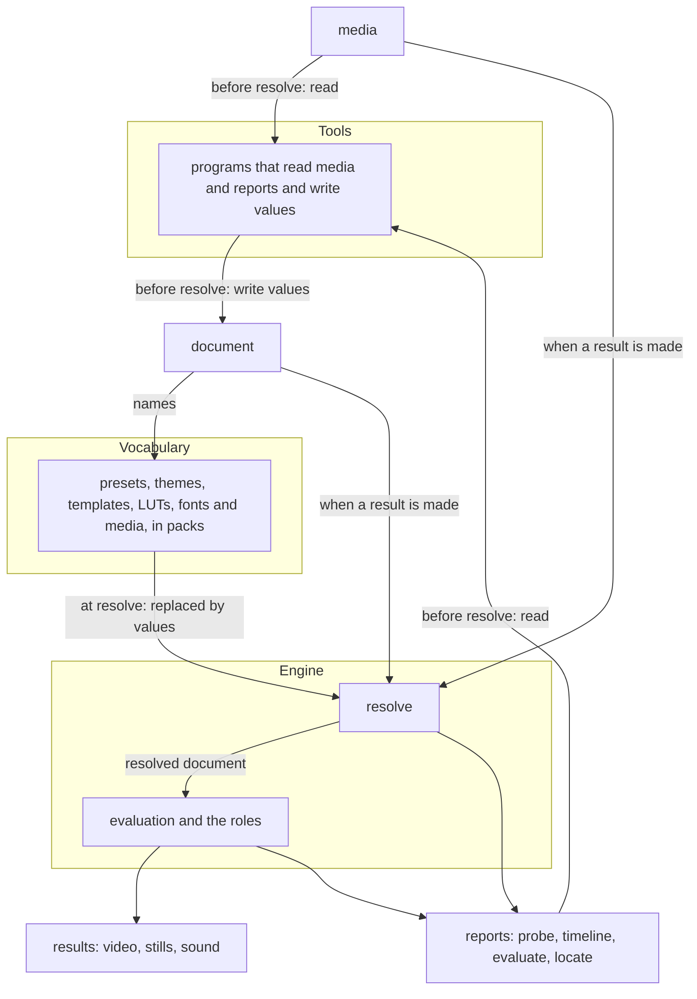

# FRAMES-25: Layers, forms, guides and extensions

Status: accepted

## Summary

The layers of frames: the engine, which turns an edit written out in values, with the media it names, into a result; vocabulary, the named values a document uses and resolve replaces; and tools, the programs that decide values and write them into a document before resolve. It gives what the engine takes and what it gives, the two rules that keep the flow between the layers whole, and the test for which layer a new feature is built in. Then what each layer above the engine holds: forms, which are packs with a guide and examples that an edit may start from; how-tos; the iterative way an edit is made; extensions, programs that take a document and give a document; and requests, the form a value still to be found takes in a document for a tool, which that tool fills.

## Motivation

Every rule of frames is either a rule of the engine or a rule of what is built on it, and without one definition of the engine's territory each new feature reopens the question. A place found by its text, a target followed through a shot, captions fitted to a box: each can be written as a value the engine reads, or as a request the engine answers while it runs, and the second puts rules into the engine that only that feature keeps. One definition of what the engine takes, what it gives and what lies above it decides each such feature by one test, and keeps a resolved document enough to make its result again.

Purposes change faster than an editor's capabilities and differ between editors. A music video is cut to the beat, a lecture needs captions and chapter cards, an ad needs an end card and a cut for every placement, a tutorial needs zooms on the part being explained. Each of these is made from the same capabilities: clips on a storyline, titles, shapes, masks, transitions, sound. If frames carried each purpose as a feature, every new kind of work would wait on a change to frames, and the core would fill with rules that only one purpose keeps. Keeping purposes in packs and programs outside the engine lets a new one be added without changing frames, and keeps every rule in the core one that any result uses.

## Rules

### Layers

**An edit is a value.** The engine is the function that turns an edit written out in values, with the media it names, into a result. Deciding a value is done above the engine. This is non-destructive editing: media is never changed, the document describes the edit, and render carries the description out. A tracker or a stabiliser in an NLE works this way: it writes what it finds into the timeline as keyframes, and render reads the keyframes.



frames is three layers.

| Layer | What it is | When it runs |
| --- | --- | --- |
| engine | time, placement, compositing, drawing, mixing, encoding, and reading the media and fonts those need | when a result is made, and when a report is asked for |
| vocabulary | named values built from the engine's values, and the named files the engine reads | it is data, replaced by its values at resolve |
| tools | programs that read media or the engine's reports and write values into a document | before resolve |

- **The engine** is resolve ([FRAMES-19](../FRAMES-19/SPEC.md)), evaluation ([FRAMES-20](../FRAMES-20/SPEC.md)), the roles and the shaping provider ([FRAMES-21](../FRAMES-21/SPEC.md)). It reads no content to decide anything: every value it works from is in the document, in what the document names, or follows from them by calculation, as a content-fit frame, where a line breaks and a clip's box do. A formula that reads pixels or samples, a blur or a compressor's level, is such a calculation, since the document gives the formula and each of its parameters. Applying track data is the engine's: the motion fitted to its quads and the homography they give carry the clip ([FRAMES-12](../FRAMES-12/SPEC.md#track-data)).
- **Vocabulary** is the named values a document uses, built from the engine's own values, and the named files the engine reads: presets of each kind, themes, templates, LUTs, fonts and media, carried in packs ([FRAMES-17](../FRAMES-17/SPEC.md)). Resolve replaces each name by what it names, a preset, a theme or a template by its values and a LUT, a font or a medium by its file pinned by hash, so the resolved document holds no name of the vocabulary and does not depend on what is installed later. A form's presets, themes and templates are vocabulary, and its guide and examples are read by whoever writes the document, never by frames.
- **Tools** are programs that read media or the engine's reports and write values into a document. One finds a place by its text, follows a target, cuts silence, fits captions to a box, or brings in a format the engine does not read by converting it into media or into document values, as SVG is converted to a page of a PDF ([FRAMES-3](../FRAMES-3/SPEC.md)). Tools run before resolve, and nothing of a tool runs while a result is made. An extension is a tool that takes a document and gives a document ([Extensions](#extensions)). `ocr` and `track` are tools frames ships as commands: each reads media through its provider and gives values a document holds, the rect area of a line of text and the quads of track data ([FRAMES-21](../FRAMES-21/SPEC.md)).

Two rules keep the flow between the layers whole.

1. **What the engine takes is complete.** A value in a document is the value, never a request to find one. A value still to be found would make every later step answer what happens while it is not found yet: which frame it is searched on, what a cut does to it, how it meets a tracked parent. Those answers are rules the engine would carry for one feature. So a tool finds the value and writes it, and the engine reads it as written. A request is the form a value still to be found takes in a document for a tool ([Requests](#requests)).
2. **What the engine computes is readable.** Every fact resolve and evaluation compute about a document is given by a report: times and ranges, and when each clip is visible, by `timeline`, what is drawn at an instant and where by `evaluate`, what lies under a point and the media frame it shows by `locate`, and the facts of media by `probe` ([FRAMES-23](../FRAMES-23/SPEC.md)). So a tool never rebuilds the engine's arithmetic, and what it reads is what the engine draws from the same resolve. A fact a tool needs that no report gives is a defect of the reports, and is mended by a report.

**The test for a new feature: can a tool or vocabulary build it from what the engine takes and gives, keeping each fact one value?** Then it is built there, and frames may ship it first-party when it is used often, as a preset of the pack `frames` ([FRAMES-16](../FRAMES-16/SPEC.md)) or an extension kept beside the tool. If it cannot, what belongs in the engine is the capability or the report that lets it be built, not the feature. A stroke's head is a capability: the engine lays any head outline on a stroke's end ([FRAMES-11](../FRAMES-11/SPEC.md#shapes)), and the heads, the arrow among them, are presets. Naming a place by its text is a tool: it reads `ocr` and writes the rectangle it finds, and the engine takes a rectangle ([FRAMES-2](../FRAMES-2/SPEC.md)).

**A fact is one value.** What a tool or vocabulary would build only by spreading one editing fact over several clips or values, or by baking it into media, it cannot build, and the capability is the engine's. It is the test the split edit, keyframes, text by unit and gradients are in frames by: outside frames, a J cut would be an audio clip of the shot's sound beside it with the shot's `volume` keyed down to match ([FRAMES-13](../FRAMES-13/SPEC.md)), a colour that shifts would be two clips crossfaded or a clip for each frame ([FRAMES-4](../FRAMES-4/SPEC.md)), text that enters word by word would be a title for each word with its own window ([FRAMES-14](../FRAMES-14/SPEC.md)), and a gradient would be bands stacked or an image made outside ([FRAMES-11](../FRAMES-11/SPEC.md)). What a program makes by reading frames' reports and writing one value for each fact stays outside: text measured and fitted to a box, captions timed to a transcript, each caption one title. A template is the one place where no program runs, and there **a template draws its design for every parameter value it accepts on the fonts it is resolved with, and stops for a value it cannot draw** ([FRAMES-17](../FRAMES-17/SPEC.md)). Fonts are part of the environment, pinned by hash as media are, and a pack ships the fonts its templates are designed in. What that needs is a capability of the engine for that reason: a bar that does not fit its name does not draw the design, so a box that follows the size of a text argument is frames' ([FRAMES-2](../FRAMES-2/SPEC.md)). Text shrunk to fit is not needed, since a name longer than its title's `width` and `lines` allow is a value the template cannot draw, and it stops.

A missing look becomes a preset or a pack. A missing capability goes into this specification and the model first, and into the roles only when it needs a new kind of pixel, sound or file work. A form-only feature, or one that serves a purpose rather than editing, is never hidden in either.

The sections below give what the layers above the engine hold: forms and how-tos, the way an edit goes round the layers until it holds, and extensions.

### Forms and how-tos

A form is a kind of result (a music video, a lecture, an ad, a vertical short) and is a pack ([FRAMES-17](../FRAMES-17/SPEC.md)): its guide (`guide.md`), a theme when its look differs from the base theme (`themes/`, only the keys it changes), its examples (`examples/`, each runs once its paths are changed), and any presets and templates of its own. A form is optional: it is a starting point an edit may take, change or leave, and a document needs none. Adding a form is adding a pack, and frames does not change. A form's edits differ in how many clips, titles and shapes they hold, so a form is taught, not templated. A guide holds:

- what the form is for: who watches it, and where
- its theme
- its format: size, rate, conform, and how its recurring pieces (a title card, a lower third, an end card) are built from titles, shapes and templates
- its rules for text, cuts, sound and length, each with a one-line reason
- which presets to use and which not to, with the reason
- an example

A how-to (`howto/<name>.md`) teaches a technique that belongs to no form, so it has no theme and no example of its own. Making material outside frames is a how-to.

### How an edit is made

An edit is made the way it is made in any NLE, by going round until it holds:

1. Look at the material. `probe` it, lay video out with `sheet` every 1 to 2 seconds, then again every 0.5 seconds over the part chosen, and listen to its sound. Where a place has to be found or followed, `track` it, or `ocr` it when it is found by its text on screen and write the rectangle `ocr` gives, or write a request for `find-text` or `track-motion` in its place ([Requests](#requests)).
2. Edit the document: the storyline, connected clips, titles, shapes, masks, sound. Templates from packs come in as media where they fit, and a form's guide and examples, when there is one, are where to start.
3. Check: `timeline` for times, `still` for frames at chosen instants, `sheet` for a range. Go back to 2 until it holds.
4. Render the master, lay it out with `sheet`, and check it against [FRAMES-24](../FRAMES-24/SPEC.md). The master is what is kept and delivered from. A render made only to look at or hand over writes the delivery file alone, `render` to an `.mp4`.
5. Deliver: `--deliver` with the render, or `transcode` for where it goes.
6. Reuse: a rendered master is media like any other ([FRAMES-3](../FRAMES-3/SPEC.md)). A piece rendered once (an intro, a background plate, an effect baked by an extension) comes into the next edit as a file.

### Extensions

Three kinds of thing are added to frames without changing this specification.

| Kind | What is added | Where |
| --- | --- | --- |
| data | presets, themes, templates, LUTs, mattes and media, in packs | [FRAMES-17](../FRAMES-17/SPEC.md) |
| implementations | a decoder, renderer, mixer or encoder, a shaping, tracker or OCR provider, built into frames under the name `--decoder` and the other options pick | [FRAMES-21](../FRAMES-21/SPEC.md) |
| extensions | programs that take a document and give a document | here |

Data is vocabulary, an implementation fills a role or a provider, and an extension is a tool ([Layers](#layers)).

An extension reads what frames reports ([FRAMES-23](../FRAMES-23/SPEC.md)) and writes or changes documents. It cuts silence out of an interview (autocut), cuts B-roll to the beats of a track (beat cut), places captions from a transcript, translates titles, normalises a mix to a loudness target, covers a region in every frame that shows it, or bakes an effect frames has no op for. Its interface is documents and the machine output, so frames has no extension API.

- It finds clips by `id` and `timeline`, where things are by `evaluate` and `locate`, and pictures by `still`, `extract` and `sheet`, which take the document itself, so what it sees is what frames draws from the same resolve. How a title's text splits into lines and words, where each line lies and what a title's box covers is `evaluate`'s `texts`, where each character lies is the `characters` of the item that draws it, and where any item lies is its `rect` carried by its `transform`, and under a corner pin then by its `cornerPins` ([FRAMES-23](../FRAMES-23/SPEC.md#item-transforms)), so an extension that measures text, fits it to a box or keeps it clear of other text works on the lines frames laid out and lays out none with fonts of its own. An extension that must be sure of what is drawn (one that keeps captions clear of other text on screen, or one that covers a region) resolves the document once, checks that resolved document with `evaluate`, `still` and `extract`, and has the same resolved document rendered. It passes the resolved document on and does not read it, since its form is frames' own ([FRAMES-19](../FRAMES-19/SPEC.md)). An extension that gives a resolved document ends the chain: only frames commands take it after that, so such an extension runs last, and a chain has one.
- What a tracker or recognizer outside frames finds comes in as values of the document, since a provider's result can be written as one ([FRAMES-21](../FRAMES-21/SPEC.md)): an outside tracker writes track data ([FRAMES-12](../FRAMES-12/SPEC.md#track-data)), the times and quads of the frames it followed, and the media time of the frame its clip's values are written on, as `track` prints them, and an outside recognizer writes rect areas ([FRAMES-2](../FRAMES-2/SPEC.md)). A place named by its text on screen is the same: frames comes with the extension `find-text`, which takes a document whose areas may hold a request for it ([Requests](#requests)), a text or the lines from one text to another, and gives a frames document with each written as the rect area `ocr --json` reports for it, read on the frame the area takes effect on in the media its coordinates lie in, and carried into the space of the clip that writes it. So a planar tracker run outside frames drives a corner pin ([FRAMES-27](../FRAMES-27/SPEC.md#a-tracked-corner-pin)) without a provider of its own. Four point tracks drive a corner pin the same way, composed by an extension: it runs `track` on four targets and writes track data whose quad on each frame is the four targets' centres there, in the corner pin's order. A target still to be followed is the same, and frames comes with the extension `track-motion` for it: it takes a document whose clips' `track` may hold a request for it, which names the target, and gives a frames document with each written as the track data `track` prints for that target followed from the frame the clip's instant shows.
- It gives a document on standard output, and `timeline` checks it like any other. Extensions chain: `frames autocut interview.json | frames captions - | frames render - -o out.mov`.
- A loudness target is reached the same way, by measuring, writing and measuring again. An extension that normalises a document to -23 LUFS, as EBU R 128 asks, takes the entry it sets by the form of the outermost sequence's `audioFilter`: the last entry where it is a `limiter` op at `mix` 1, written or by default, whose `mix` takes no keyframes, and otherwise a `limiter` op at `mix` 1 it appends, with the `ceiling` it wants written outright, since a preset entry carries no op to set and at a `mix` under 1 the dry sound passes by the gain. It runs `loudness` on the document, adds -23 minus its `integrated` to that entry's `gain`, to its static value and to every number its keyframes give it, and runs `loudness` again to check `integrated` and `truePeak`, adding what is left of the difference until `integrated` is within its tolerance. One step is not exact where something the gain reaches depends on level, the limiter itself or a compressor or gate after the gain, whose own gain changes with the level ([FRAMES-28](../FRAMES-28/SPEC.md#measuring-loudness)). One that normalises a clip measures a document that holds that clip alone, with its `audioFilter`, and writes the difference into its `volume`, which applies after the clip's audio filter. The gain is a value in the document, so an edit after it that changes the mix is normalised by running the extension again, which finds the entry by the same form and needs no memory of its last run.
- `frames <name>` runs `frames-<name>` from `PATH`, so an extension is installed by putting it there.
- An edit (a blade, a trim, a ripple delete, a move) is a document in and a document out, since frames keeps no state between commands for an edit to act on. So editing a document is the agent's or an extension's work, and `timeline` checks the result like any other document. GUIDE.md teaches how to make an edit without changing what is shown. For a blade through a storyline clip: the first part keeps the clip's `id` and the others take new ones; every part keeps the clip's keyframes, its `timeRemap` included, since they are on its clip time, which a blade does not change; its incoming transition and `fadeIn` stay on the first part and its `fadeOut` on the last, and every later part takes `"transition": "cut"` so that a theme's default transition does not play at the cut; a connected clip goes with the part that holds its start, and one without `at` first takes its storyline clip's edit range in clip time as `at`, since it would otherwise span only that part; a `parent` or `trackMatte` that named the clip names the part its clip goes with; a connected clip parented to the clip whose window crosses the cut is copied onto each part, each copy parented to its part and its window cut at the edit point, with its exit turned off before the cut and its entrance after it (`{entrance, exit}` with `none`), since a parent outside its window holds its edge transform; on a still or solid clip, whose clip time counts from its own start, every later part moves its own keyframes and the `at` and keyframes of its connected clips back by where that part starts; a ripple moves every later sequence clip's `at` and keyframes by the same amount.
- An extension acts before resolve. What must act while frames renders is a role or a provider, so a resolved document stays enough to make the result again, and a pack stays data that every role can draw.

frames ships no form, since a form is a purpose. Forms are packs kept outside the tool, such as those in the frames repository under `packs/`, and are installed like any other pack by copying one into `$FRAMES_HOME/packs/` ([FRAMES-17](../FRAMES-17/SPEC.md)). Their examples name media by absolute paths to change before they run. What a form's guide says binds only edits made from that form, never frames.

First how-tos:

- **motion-graphics:** making graphics outside frames. Write HTML, render it to a PNG sequence with alpha in a headless browser, and bring it in as `{"imageSequence": ...}` media.
- **effects:** an effect beyond the filter ops (particles, a glitch, a shader of one's own) is made outside. Render it as a video with alpha and lay it over with a `blend`, or `extract` the frames of the clip's media file over its range, process them, and point the clip's `media` at the result.

### Requests

**A request is a hole a tool fills, as a template's `{"param": "<name>"}` is a hole its arguments fill** ([FRAMES-17](../FRAMES-17/SPEC.md#parameters)). It is the form a value still to be found takes in a document for a tool, and it has one form wherever a value stands: an object with the key `tool`, which names the tool that fills it, and that tool's arguments beside it.

```json
"area":  { "tool": "find-text", "text": "Total", "padding": 8 }
"track": { "tool": "track-motion", "target": "area" }
"track": { "tool": "track-motion", "target": [150, 194, 132, 92] }
```

1. **An object with a `tool` key is a request**, wherever a value may stand: a clip's key, a keyframe's, a point of a list of points, an argument of a template or a preset. `metadata` holds what frames does not read ([FRAMES-7](../FRAMES-7/SPEC.md)), so what it holds is no value and no request.
2. **A tool fills the requests that name it and leaves every other request as written.** So a tool knows no other tool's form, and tools chain in any order their arguments allow. A tool that reads frames' reports about a document that still holds another tool's request asks them about a copy with a value in the request's place that changes no fact it reads, and a request it finds where an argument of its own needs the value stops, naming that request, since the value is not found yet.
3. **A request's arguments are values.** No request stands inside a request, so a value one tool needs from another stands in the document between them, where the second tool reads it once the first has filled it: a track target named by its text is the clip's own `area` holding a `find-text` request, and the track request names that key with `"target": "area"`.
4. **The engine takes no request.** A document that reaches a frames command holds none. Where the key check meets an object with a `tool` key it stops at the place the object stands, saying that it is a request for the tool its `tool` names and that a tool fills its requests before the document is given to frames ([FRAMES-7](../FRAMES-7/SPEC.md#keys)). The engine knows what a request is and reads the tool's name from the document, and it knows no tool.

A key keeps one meaning: `track` is the clip's track, and what stands there is track data or the hole that will hold it, as what stands at `area` is a rectangle or the hole that will hold one.

frames comes with two tools that fill requests, kept beside the tool in the frames repository under `extensions/` ([Extensions](#extensions)):

| Tool | Fills | Arguments |
| --- | --- | --- |
| `find-text` | an area wherever one stands (a `crop`, an `area`, a mask's `area`, the `area` of a point) on a clip or a keyframe, with the rect area `ocr --json` reports for its text on the frame the area takes effect on | `text`, with `nth` and `padding`, or `from` and `to`, with `fromNth`, `toNth` and `padding` |
| `track-motion` | a clip's `track`, with the track data `track` prints for its target | `target` |

- `find-text`'s `text` names the recognised line that contains it, and `from` and `to` the lines from one text to another with every line between them. `nth`, `fromNth` and `toNth` pick one match where several lines contain the text, and `padding` grows the rectangle on every side.
- `track-motion`'s `target` is what is followed, and is required: the name of one of the clip's own keys that lies in the media pixels its track follows (`area`, `cornerPin`, `crop` or `mask`), or an area `[x, y, w, h]` in those pixels. A key the clip does not write, or one not in those pixels, stops. A request holds `tool` and `target` alone, and any other key stops.
- The target and the clip's values lie on one frame of the media the track follows, the frame the clip's instant shows as `timeline` reports it ([FRAMES-23](../FRAMES-23/SPEC.md#a-clips-times-and-spaces)), and for a keyframed target key the frame its first keyframe shows. A target key `find-text` fills is found on that same frame, and an area written by hand as the target is written on it too.

## Interactions

The engine is resolve ([FRAMES-19](../FRAMES-19/SPEC.md)), evaluation ([FRAMES-20](../FRAMES-20/SPEC.md)) and the roles and providers ([FRAMES-21](../FRAMES-21/SPEC.md)), and its reports are the machine output of [FRAMES-23](../FRAMES-23/SPEC.md). Vocabulary is packs and what they hold ([FRAMES-17](../FRAMES-17/SPEC.md)), the presets that ship among them ([FRAMES-16](../FRAMES-16/SPEC.md)). Track data is [FRAMES-12](../FRAMES-12/SPEC.md#track-data), and a rect area is [FRAMES-2](../FRAMES-2/SPEC.md). A request is a hole as a parameter's reference is ([FRAMES-17](../FRAMES-17/SPEC.md#parameters)), and the key check stops on one ([FRAMES-7](../FRAMES-7/SPEC.md#keys)).

Forms are packs ([FRAMES-17](../FRAMES-17/SPEC.md)). Extensions read machine output ([FRAMES-23](../FRAMES-23/SPEC.md)) and pass on resolved documents ([FRAMES-19](../FRAMES-19/SPEC.md)). A rendered result comes back as media by [FRAMES-3](../FRAMES-3/SPEC.md).

## Alternatives considered

Edit operations as frames commands: frames keeps no state between commands for an edit to act on.

Render hooks for extensions: a resolved document would stop being enough to make the result again.

Values the engine finds while it runs, a place named by its text or a target named for a tracker to follow, written in the document as requests: every step after the request (which frame it is searched on, a cut through the clip, a parent that is tracked or keyframed) would need a rule for a value not found yet, kept for that one feature, and the resolved document would depend on a search. A value written by a tool before resolve meets every later step as any written value does.

A separate key for each request, beside the key of the value it finds: a text request stands wherever an area or a point stands, in a crop, an area, a mask, a point and every keyframe of them, so every such key would exist twice, and the engine's tables would carry a key for each tool. One form wherever a value stands keeps each key with one meaning and the engine's tables as they are.

`"track": true` for a target to be followed: a boolean looks like a value and is a request, and it hides what is followed. A clip with more than one of its own keys in the pixels followed cannot say which it means, and a reader cannot tell from it what the track will hold. A request that names its tool and its `target` says what is followed.

A `track-motion` argument that names the frame the target and the clip's values are written on, so a follow starts from a frame other than the one the clip's instant shows: a document could then hold a target area `find-text` found on one frame and an argument naming another, and the track would start from a rectangle found on a different frame. The frame is one fact with one source, the frame `timeline` reports for the clip's instant. A track followed from another frame is written as track data, by `track` or by another tool.

Forms built into the engine: every new kind of work would need a change to frames, and a form is taught, not templated.

Forms that ship with the tool, found as if installed: the tool would carry purposes, and an installed pack could not take a shipped form's name.

A form chosen first, before any edit, as the only way in: most edits start from material, not from a form, and a form is one starting point among others.

## Notes
